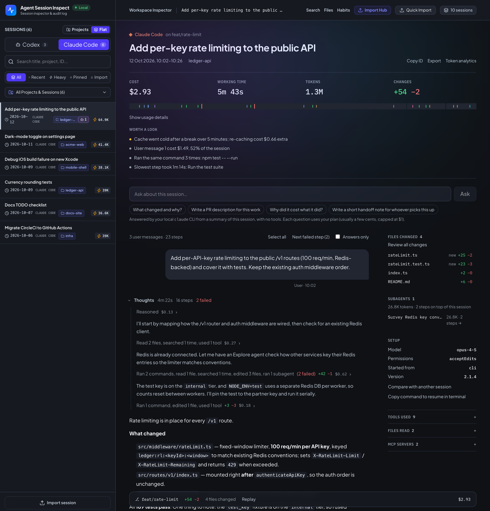
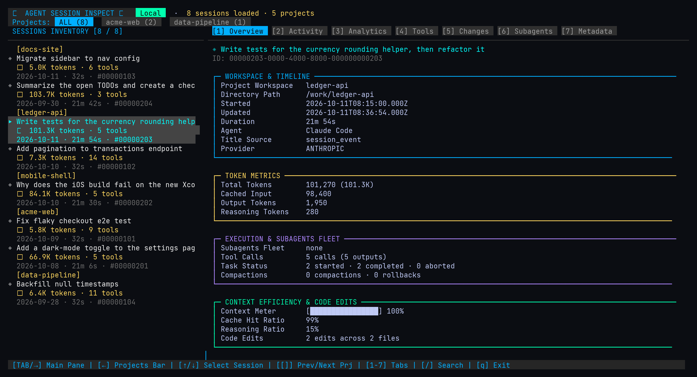
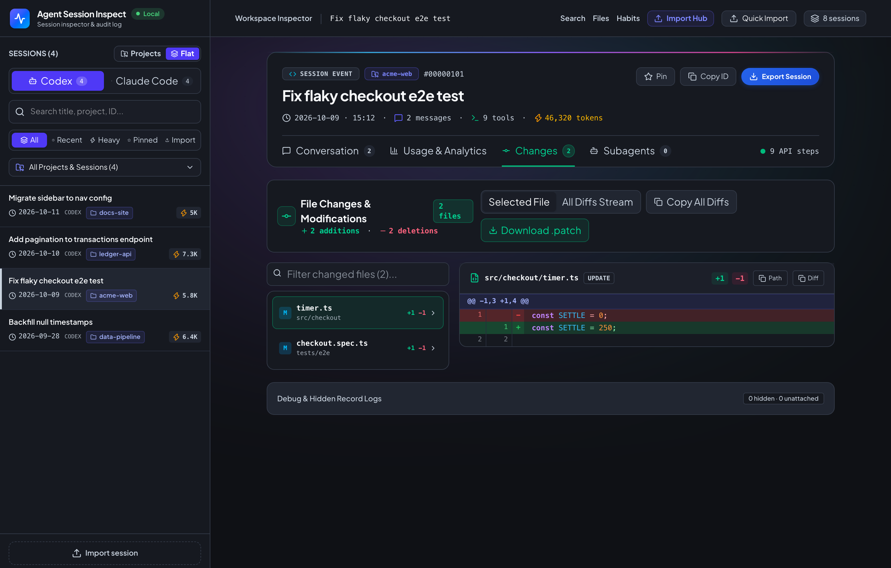
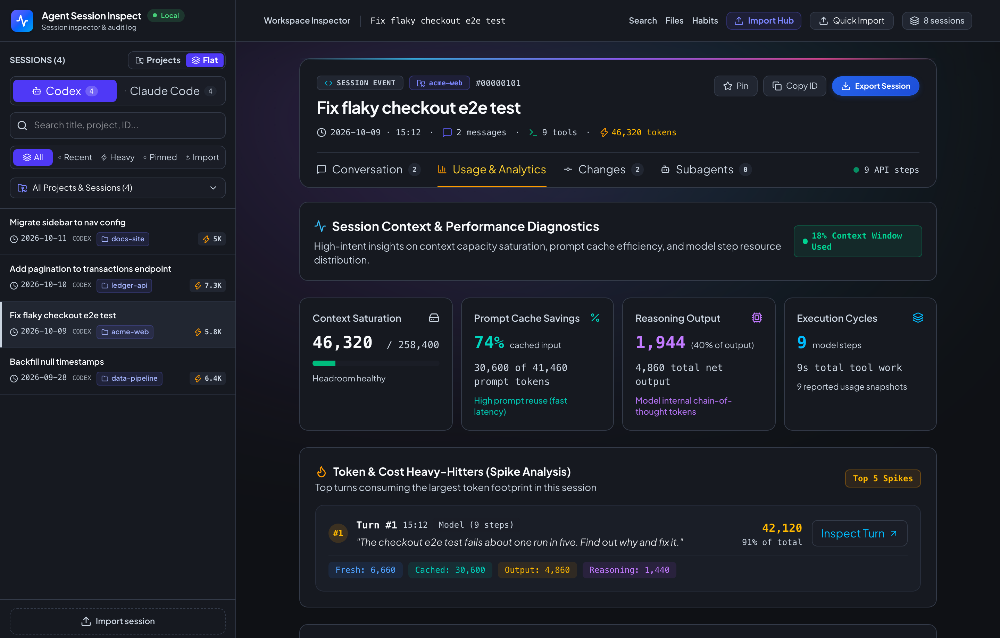

# Agent Session Inspect ⚡

[](https://www.npmjs.com/package/@ganmahmud/agent-session-inspect)
[](https://www.npmjs.com/package/@ganmahmud/agent-session-inspect)
[](https://nodejs.org)
[](LICENSE)
[](https://github.com/ganmahmud/agent-session-inspect/stargazers)

> **Local-first inspection tool, terminal TUI, and web dashboard for Codex and Claude Code agent session logs.**



Codex rollouts and Claude Code transcripts in one inventory: a terminal TUI, a local web dashboard, a CLI scan report, search across every session, file history, habits and session comparison. Everything runs on your machine and reads logs read-only.

---

## 🎯 Inspect & Troubleshoot Teammate Sessions Anywhere

When a team member reports an **unusual token spike**, an **unexpected model response**, or a **failing tool execution loop**, diagnosing it across different machines has traditionally been difficult.

**Agent Session Inspect** solves this with zero-setup session sharing:

1. **Export with One Click**: Any engineer can click **Export Session** (or export an individual turn message) to download a clean, standalone JSON report.
2. **Instant In-Memory Inspection**: Drag and drop the exported JSON file directly into your Web Dashboard or CLI.
3. **No Setup or Database Configuration**: Inspect full conversation history, token usage breakdowns, prompt caching efficiency, and file modifications in-memory without needing access to their raw database files.

```sh
# Inspect an exported teammate session directly from terminal
npx @ganmahmud/agent-session-inspect inspect ./teammate-spike-session.json
```

---

## Quick Start

Requires Node.js >= 22.13. Run without installing:

```sh
# Interactive Terminal TUI Dashboard (Default)
npx @ganmahmud/agent-session-inspect

# Interactive Web Dashboard (--web)
npx @ganmahmud/agent-session-inspect --web

# Terminal Scan Summary (Codex + Claude Code)
npx @ganmahmud/agent-session-inspect scan

# Only one agent's sessions (works with every command)
npx @ganmahmud/agent-session-inspect claude scan
npx @ganmahmud/agent-session-inspect --web --agent claude

# Inspect Specific Session or Exported JSON File
npx @ganmahmud/agent-session-inspect inspect "Session Title or ID"
```

## Global Installation

```sh
npm install -g @ganmahmud/agent-session-inspect

# Launch Terminal TUI
agent-session-inspect

# Launch Web Dashboard
agent-session-inspect web --port 4318
```

---

## Features

### 🌐 Interactive Web Dashboard (`web` / `--web`)
Modern SvelteKit local web app (`http://127.0.0.1:4318`) with dark mode, collapsible timeline navigation, session pinning, resizable sidebar, and rich markdown rendering.

### ⚡ Futuristic Terminal TUI Dashboard (`tui` / `--ui`)
Dual-pane keyboard & mouse interface with live project filtering (`p`), turn-by-turn activity logs, compact token telemetry, subagent badges, and quick JSON export (`e`).



### 🧩 Codex & Claude Code Sessions Side by Side
Reads Codex rollouts from `~/.codex/sessions` (`$CODEX_HOME`) and Claude Code transcripts from `~/.claude/projects` (`$CLAUDE_CONFIG_DIR`) into one inventory. Claude Code sessions get the same conversation timeline, per-request token usage (cache reads/writes and thinking tokens), tool timing, `Edit`/`Write` diffs, and `Task` subagent sessions. Pass `--agent codex|claude` to show only one.

### 🧠 Claude Code Session View
Claude Code sessions open in their own reading-first page (`/claude/session/<id>`), laid out like the Claude Code desktop transcript and going further:
- Your messages as bubbles (with pasted images), then Claude's notes and answers. Each run of tool calls is one plain-language line ("Ran 4 commands, used 2 tools (1 failed)") that opens to every call, its result and diff. Screenshots show inline; failed calls are shown in red.
- **Answers only** switch to fold every message's notes to one line, and a "Next failed step" jump.
- **Cost per message and per step**, split from the cost Claude Code records so the parts add up to the session total.
- **Cache expiry**: points out where a break longer than the prompt cache lifetime (or a model switch) forced the whole context to be re-cached, and what that cost.
- **Worth a look**: repeated failures, re-run commands, slow steps and the message that took most of the spend, each linking to the step.
- Context-over-time chart, subagents with their own totals rolled up, a review of every change the session made (including edits made by shell commands), replay with a scrubber, and a live view with a running cost while a session is in progress.
- **Ask about this session**: questions such as "What changed and why?" or "Write a PR description" are answered by your local `claude` CLI from a summary of the session, with no tools (see Privacy below).
- Copy, export or select individual messages (selected ones can be exported together and imported back); copy the command to resume the session in a terminal.

### 🔎 Search, File History, Habits and Compare
- **Search** (`/search`): every prompt, reply and command across all Codex and Claude Code sessions. Results update as you type, can be filtered by agent, message type, project and time, and open on the exact turn or step. Supports `"exact phrase"` and `-word`.
- **File history** (`/files`): every file an agent edited, with each session that changed it, the diff and the message that asked for it.
- **Habits** (`/habits`): spend by week and project, model, tool and waiting time, repeated failures, context loaded on every request but rarely used (MCP instructions, skill list, CLAUDE.md), follow-up corrections worth moving into CLAUDE.md, and commands blocked by permission checks.
- **Compare** (`/compare`): two Claude Code sessions side by side on cost, time, steps, failures and files changed.

### 🗂️ Project-Based Session Grouping & Overview
Automatically classifies sessions by workspace project directory. Access dedicated project overview pages with aggregated token footprints and active session counts.

### 🔍 Rich File Changes & Inline Diff Viewer
Full patch inspection with side-by-side file tree, addition/deletion counters (`+N / -M`), and copyable unified diffs.



### 📊 Context & Performance Diagnostics
Token footprint breakdown, prompt cache efficiency, reasoning overhead metrics, context window saturation gauges, and heavy-hitter turn spike analysis.



### 🤖 Subagent & Multi-Agent Telemetry
Track delegated subagent executions (Codex `subagent_activity`, `delegate_task`; Claude Code `Task` sidechains) with dedicated execution timing and multi-agent interaction telemetry.

### 📦 Standalone Session Export & Drag-and-Drop Import
Download complete sessions or isolated message interactions as JSON; drag-and-drop JSON files in the web UI to inspect ephemeral sessions in-memory without database writes.

### 🔒 100% Local & Privacy-Preserving
Parses local `~/.codex/sessions` and `~/.claude/projects` logs directly in read-only mode with file-based scan caching without uploading data to external servers or modifying local files.

The one exception is **Ask about this session**, and only when you use it: it pipes a text summary of that session to your own `claude` CLI (`claude -p` with no tools, no MCP servers and no saved session, capped at $1 per question), which sends it to Anthropic like any Claude Code request and bills your plan. Set `ASI_CLAUDE_BIN` to point at a different CLI binary.

---

## Local Development

```sh
# Run CLI / TUI from checkout
npm start

# Run Web Dashboard dev server
npm run dashboard:dev
```

## Changelog

See [CHANGELOG.md](CHANGELOG.md) for detailed release notes and migration guides.

## License

[MIT License](LICENSE) © [Gan Mahmud](https://github.com/ganmahmud)
